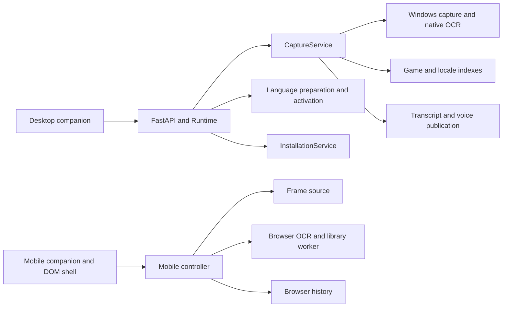
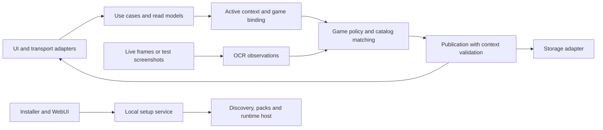

# Rework architecture study

Status: **design proposal, not application implementation**. The original study
examined upstream `387631f76fe2687d036bef6e8617cb4962e7c4a2` on 2026-10-24
(0.19.2 plus PR #35). This revision incorporates the owner's review: English-only
engineering documentation, equal consideration of supported games, screenshot
regressions, sampled language combinations, mobile-package testing and a smaller,
necessary test suite. No new runtime, device or real-package verification is claimed.

The [roadmap](rework-roadmap.md) assigns the work. The
[screenshot regression plan](screenshot-regression-plan.md) defines fixture,
package, hosted-execution and privacy requirements. Existing
[runtime contracts](runtime-context.md), [language/account rules](languages-and-accounts.md)
and the [AI workflow](ai-development-workflow.md) remain applicable.

## Recommendation

Retain the Python backend, ordinary desktop browser and independent mobile
browser app. Clarify ownership of transport, runtime composition, game/locale
activation, recognition policy, publication and storage. A common engine or new
programming language is not a prerequisite for matching observable behavior.

The useful changes are an explicit active game/locale binding, one mobile
production controller usable by both UI and screenshot tests, and separate
observation/policy/publication responsibilities in desktop capture. Protect
those boundaries with relevant characterization before extraction. File size
alone is not a reason to rewrite a module. Performance improvements remain
unmeasured until the relevant baseline and comparison exist.

## Current boundaries and evidence

This is a responsibility map, not a complete network diagram. PC pairing, VDO
transport and the Lexirise gateway have separate boundaries.

| Observation at the study commit | Source and consequence | Needed change |
| --- | --- | --- |
| API combines composition and mutable runtime policy | [Runtime](../backend/api.py): activation writes capture indexes, voice fields and `_scan_epoch` | One explicit activation owner and coherent binding; splitting routers alone is insufficient |
| Capture combines observation, game policy, persistence and callbacks | [CaptureService](../backend/capture.py): scans and audio scheduling | Extract one route at a time with existing errors and publication rules preserved |
| Matching varies across routes | [Legacy](../backend/textmaps.py), [multilingual](../backend/multilingual_index.py), [mobile](../public/mobile-capture/library.mjs) | Shared behavioral examples; distinguish legitimate engine differences from semantic defects |
| Geometry can imply an unsupported story order | Desktop spatial grouping and mobile batch timestamps | Distinguish observation, content identity, occurrence, display order and proven story order |
| Mobile controller reads DOM and owns module-global state | [mobile-ui.mjs](../public/mobile-capture/mobile-ui.mjs) | One controller with injectable I/O and a thin DOM shell, preserving resource release |
| Existing replay does not cover all production policy | [Mobile replay](../scripts/replay-mobile-ocr.mjs) has its own stable/set loop; [desktop replay](../scripts/replay-video-ocr.py) can miss specialized routes | Characterize production first; use the same controllers for screenshot replay and assert route choice |
| Setup combines physical packs and prepared-index information | [InstallationService](../backend/installation.py), [paths](../backend/game_paths.py) | Separate candidate, physical presence, reader support and index readiness |
| A native OCR timeout does not establish termination | Capture rotates an executor on timeout | Measure and fault-inject before proposing a managed worker process |

These are code observations, not new native reproductions. Special-case code in
one game does not establish complete coverage for that game or justify prioritizing
it over others. Inventory actual presentations in every active adapter.

## Preserve existing solutions

PR #34 already added independent mobile ZZZ comic matches, per-bubble confirmation,
dark/light bubble handling and voice recovery within original locales. Preserve
[confirmation](../public/mobile-capture/caption-confirmation.mjs), the
[OCR pipeline](../public/mobile-capture/ocr-pipeline.mjs) and current scan behavior;
R10 investigates remaining evidence gaps instead of rebuilding these features.

PR #35 added the [searchable game picker](../app/game-picker.tsx), account-aware
language selection, request ownership and persistent local translation targets.
The older 0.19.1 findings must not be presented as current behavior.

Also retain:

- [StateVersion](../backend/state_version.py) and [state reconciliation](../app/state-sync.ts):
  runtime IDs, revisions, account generations and request ownership. No second event bus.
- [Language preparation](../backend/language_preparation.py) and
  [Windows process management](../backend/windows_preparation_process.py): job
  ownership, cancellation, lock order and atomic index publication. Incomplete
  cleanup is not successful quiescence.
- [Receiver source](../public/mobile-capture/receiver-source.mjs): session/revision
  validation and frame release. Screenshot injection should use this boundary.
- Existing game readers, transcript stores and protected account storage. Neither
  a dynamic plugin framework nor database replacement has a demonstrated need.
- [Runtime handoff](../backend/runtime_handoff.py), the
  [updater](../scripts/update-companion.ps1) and
  [launcher](../scripts/companion-runtime.ps1): standby, readiness, quiescence,
  takeover and recovery. New state needs an explicit handoff policy.

## Target responsibilities

Python and browser JavaScript retain their platform implementations. These arrows
do not introduce network services. Existing adapters remain during migration.

### D1 — Composition and explicit use cases

Runtime constructs services and owns lifecycle. Routes validate input and call
use cases; they do not select game/voice bindings by mutating private capture
fields. Start with activation and the lifecycle boundary needed by packaging.
Do not introduce a general dependency-injection framework. Moving route files
without changing ownership would leave the underlying coupling intact.

### D2 — Context and transcript identity

An active binding coherently identifies the game, source locale, catalog version,
voice binding and relevant context/generation. Capture context before asynchronous
work and validate it at publication. Account A → B → A, language/source switches
and runtime takeover must not revalidate old work.

| Concept | Contract |
| --- | --- |
| Context | Existing runtime/account/source/language generations own their domains; revisions from different runtimes are not comparable |
| Observation | Source/frame identity, observation time, crop/channel and OCR text; relate source and processing clocks explicitly |
| Content identity | Verified game, locale and catalog/voice identity; an OCR fragment is not a new catalog line |
| Occurrence | One appearance/utterance; movement retains identity while a genuine later repetition may be new |
| Order | Validated authored order, otherwise reliable observation order, otherwise explicitly unknown |
| Publication | One current owner decides persistence/output; completion time and array position are not story-order evidence |

These are semantic requirements, not prescribed new field names. Version only
interfaces shared with consumers or persistent data. Preserve existing wire
adapters. New occurrence state needs a preserve/derive/reset policy across
handoff, with its effect on duplicate suppression verified.

### D3 — Game-specific behavior without a universal engine

Retain native desktop and browser OCR. Keep crop/channel selection, fragment and
ambiguity rules, catalog matching and voice eligibility explicit per game, apart
from asset extraction. Common fixtures express observable guarantees; raw OCR
text may differ between engines. Do not erase context-dependent dialogue, player
variants or explicitly supported unvoiced lines with a generic heuristic.

Use a presentation inventory to discover holes beyond comics: overhead chatter,
centered cards, wrapped captions, light/legacy panels, page fragments, choices
and HUD false positives. The [screenshot plan](screenshot-regression-plan.md)
lists concrete starting points and requires an entry for every active game.
Reported defects and distinct uncovered behavior determine work order, not game
name or the amount of existing special handling.

### D4 — One mobile controller for UI and regression execution

A controller factory receives source, clock, OCR, package/library matching,
storage and event output as narrow dependencies. It owns scan intent, epochs,
confirmation, pending work and stop/close. The DOM shell translates controls and
renders state without a second recognition decision loop. Keep existing worker
and receiver boundaries rather than introducing a general frontend state library.

The primary regression input is a fixed screenshot and an actual-format mobile
package. Use real OCR in selected image tests, and controlled observations in
cheap temporal tests. Load the package through the production importer, then
exercise actual matching, transcript, translation and voice binding. Build and
test the packaged mobile artifact, not just loose source modules. Injected OCR
or synthetic tones must be identified as such in results.

A single screenshot proves visible content, not chronology. Ordered screenshot
sequences with independent annotations cover scroll, repetition, duplicates,
late completion and source changes. No live YouTube playback dependency is
needed. Existing video tools may remain for an independently justified measurement;
they are not the required corpus acquisition or PR execution path.

### D5 — Shared setup service and explicit host/storage boundaries

The [R18 inventory and prototype decision](r18-runtime-inventory.md) now supplies
the [R12c storage/host design contract](r18-storage-host-contract.md), reviewed
against upstream `4a4abfc` on 2026-10-28. R14 adoption, source/frozen adapters and
R19 artifact/native validation remain separate implementation work.

Installer and WebUI use the same validation and preparation. Separate immutable
resources, persistent data, caches, host settings and protected credentials.
Source and bundle adapters own resource paths and start/readiness/stop. Status
reads must not prepare files or write to accounts.

Retain InstallationService and updater contracts. Program and user-data migrations
must be independently recoverable. A static frontend remains an experiment:
origin, API/WebSocket routes, assets, OCR workers and service-worker updates are
compatibility requirements. Copying files does not move localStorage/IndexedDB
to another origin. Preserve the ordinary browser for Browser Extension mode.

### D6 — Native isolation only for a measured problem

Cancelling a running future does not terminate a native call; that alone does not
prove a toolkit hang. R23 requires a specific recovery/performance hypothesis.
First compare the current path with a managed Python worker behind the same
contract. Test hang/crash, late response, failed startup, source changes and
updates during work. Backend remains the publication owner. Termination must
bound cleanup and replace damaged IPC without competing with existing Windows
Job Object management.

Consider Rust/C# only for a property the simpler approach cannot satisfy. No
language rewrite, Tauri shell or native worker is a prerequisite for bundling.
A PyInstaller directory bundle is an option to validate, not evidence that all
resources and game tools already work. The
[roadmap](rework-roadmap.md#decisions-requiring-evidence) records these decisions.

### D7 — Bounded screenshot and language coverage

Use one versioned manifest/runner contract across games. Record image and package
digests, game/patch, presentation, independent language fields, expected/forbidden
catalog identities, route and evidence classification. Start with three to five
supported language combinations across the selected corpus, with fixed bug
regressions and a small rotating supplemental sample. Avoid an exhaustive matrix.

The owner's ZZZ package is a candidate pilot input whose access, content and
locales still need inspection. The harness must accept other games through the
same contract. A public synthetic package proves package mechanics; only a
corresponding real-package run establishes that package's bindings.

Public GitHub checks use authored screenshots/packages. Real screenshots and
extracted libraries remain private under repository rules. Local execution is
the default for them; optional real-input hosted processing must meet all trust,
input-access and output restrictions in the screenshot plan. Do not promise the
supplied Drive package is already available or suitable for public CI.

### D8 — Necessary tests on supported targets

Windows is the supported desktop target. Relevant macOS/WebKit jobs provide
mobile-browser evidence, not macOS desktop support. Do not add or retain Linux
product/browser verification as a rework requirement. A Linux runner used solely
to publish static assets is infrastructure, not a Linux support test; keep that
distinction explicit when changing workflows.

R25 reviews the existing thousand-plus Python tests and related browser jobs by
unique failure protected, supported behavior, runtime cost and duplication.
Consolidate or remove redundant, obsolete and implementation-mirroring tests with
a documented replacement or retirement rationale. Preserve meaningful regression,
data/account isolation, publication, migration and lifecycle coverage. A large
count alone is neither a reason to retain tests nor a deletion target.

New tests require the same justification. Prefer the cheapest layer that detects
the failure, a few real OCR/package integration cases and selected browser checks.
Measure elapsed time, build/load fixtures once, avoid duplicate suites for a
commit, and expand only when new evidence warrants it. Documentation changes do
not require OCR, full Python or browser runs.

## Migration without circular dependencies

1. W1 defines the relevant status/read-model contract (R12a) and extracts only
   needed subscriptions (R13d). Labels and update UI can proceed independently.
2. W2 inventories presentation gaps and annotates screenshots (R01), then
   characterizes the current production page (R07a). Mobile extraction (R13c)
   precedes controller-driven screenshot replay (R07b), not the other way around.
3. W2 defines context/identity (R12b), makes activation explicit where needed
   (R13b), and fixes matching/temporal defects separately in R08–R10. Extract
   observation/policy/publication (R13e) only where the affected route needs it.
4. W3 delivers the small shared storage/host contract (R12c within R14/R18),
   relevant setup extraction (R13a), then bundle/installer/migration evidence.
   R19 can bundle the existing runtime without waiting for OCR or a language trial.
5. R25 improves the relevant test areas incrementally; it is not a new global
   approval phase before every independent task.

R07a can control frame/OCR/clock/catalog I/O while retaining production scan,
confirmation, history and publication. Known failures stay separate from desired
expectations. R13c proves equivalent outputs before/after extraction plus correct
cleanup. R07b later replaces duplicate replay decisions with that same controller.
Pure extraction and behavior fixes have separate commits and rollback paths.

## Evidence limits

Existing state-sync, account/UI, caption-confirmation, mobile-library, capture,
runtime-handoff, preparation and installation checks are starting evidence to
reuse, not a mandate to rerun all suites for every change. R25 reviews them before
adding overlapping tests. Keep source/built-frontend/installed-artifact evidence
distinct: [setup-build-e2e](../scripts/setup-build-e2e.mjs) uses checkout Wrangler,
a mocked backend and blocked service workers. It does not prove a self-contained
installer or browser-origin migration.

Historical research probe: on Node 22.22.2/macOS,
`node --test tests/caption-confirmation.test.mjs tests/mobile-transcript.test.mjs tests/state-sync.test.mjs`
passed thirteen tests but the combined command failed because generated
`pairing/fflate.mjs` was missing. This is incomplete asset preparation, not a
passed transcript suite or a reproduced product defect. `npm test` normally
prepares those assets. That historical probe is not a current validation run.

Open evidence includes native Windows OCR/capture, physical iOS behavior,
performance baselines, sampled real-package bindings and the new installed
candidate. A skipped Windows test on another host is not a pass. Documentation
checks for this revision are recorded separately and complete no implementation
task or product milestone.
