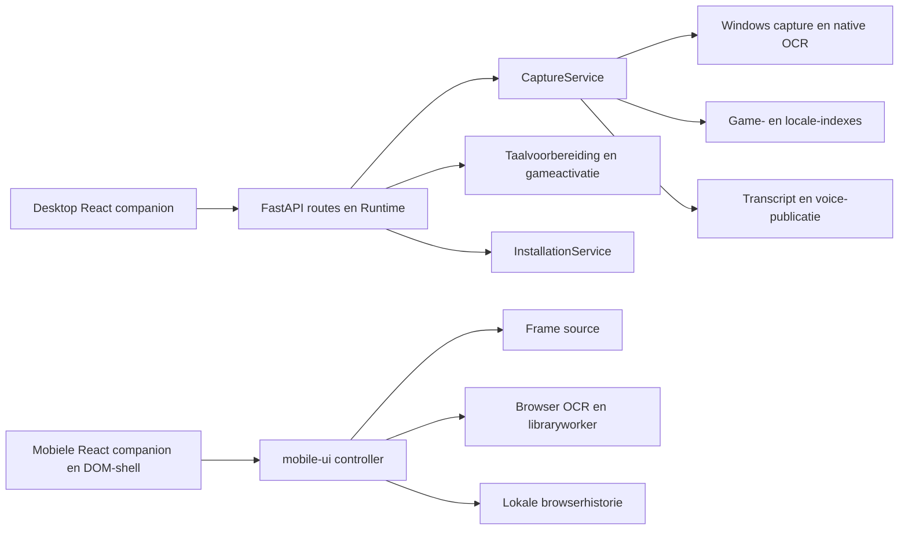
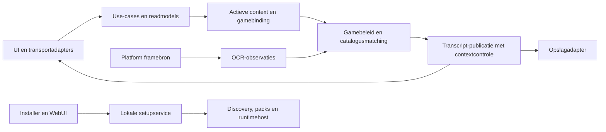

# Architectuuronderzoek voor de rework

Status: **ontwerpvoorstel, geen applicatie-implementatie**. Onderzocht op
2026-10-24 tegen upstream `387631f76fe2687d036bef6e8617cb4962e7c4a2`
(0.19.2 plus PR #35); de onderzoeksbranch bevat daarnaast alleen documentatie.
Drie parallelle analyses behandelden de huidige architectuur, doelgrenzen en
migratie/platformkeuze. De conclusies zijn tegen broncode en bestaande tests
getoetst. Een broncode-observatie is geen nieuwe praktijkmeting.

Dit document onderbouwt de [roadmap](rework-roadmap.md). De concrete opdrachten
staan daar; dit document beschrijft waarom die grenzen en volgorde nodig zijn.
De [runtimecontracten](runtime-context.md), [taal-/accountregels](languages-and-accounts.md)
en [AI-werkwijze](ai-development-workflow.md) blijven van toepassing.

## Conclusie

Behoud de Pythonbackend, lokale browser en zelfstandige mobiele browserapp.
Verfijn de bestaande modules tot een modulaire monoliet met expliciete eigenaren:
transport, runtimecompositie, game-/taalactivatie, herkenningsbeleid, publicatie
en opslag. Mobiel blijft een eigen runtime met dezelfde waarneembare semantiek;
een gedeelde engine of nieuwe programmeertaal is geen voorwaarde.

De hoogste opbrengst verwachten we van drie concrete veranderingen:

1. Eén expliciete actieve game-/taalbinding, zodat de API geen capture-private
   velden hoeft te veranderen om catalogus en voices te wisselen.
2. Een mobiele productiecontroller die zonder DOM kan draaien, waardoor replay
   werkelijk dezelfde beslislogica test als de applicatie.
3. Afzonderlijke observatie-, gamebeleid- en publicatiegrenzen in desktopcapture,
   beschermd met sequentietests voordat gedrag of locatie van code verandert.

Dit zijn ontwerpkeuzes op basis van coupling en ontbrekend testbewijs. Winst in
snelheid, geheugen of herkenningspercentage is nog niet gemeten. Grote bestanden
alleen zijn geen reden voor een herschrijving.

## Huidige architectuur en aangetoonde knelpunten

De kaart toont de hoofdverantwoordelijkheden; zij is geen volledige netwerkkaart.
PC-pairing, VDO-transport en de Lexirise-gateway hebben afzonderlijke grenzen.

| Observatie op de onderzoekscommit | Bron en betekenis | Benodigde verbetering |
| --- | --- | --- |
| API bevat compositie én mutabel runtimebeleid | [Runtime](../backend/api.py), `__init__`, `build_language`, `activate_language`; activatie schrijft ook `capture.textmaps`, voicevelden en `_scan_epoch` | Maak activatie een expliciete operatie met één eigenaar en een coherente binding; alleen routebestanden opsplitsen is onvoldoende |
| Capture mengt waarneming, gamebeleid, opslag en callbacks | [CaptureService](../backend/capture.py), `_scan_once`, game-scans, `_schedule_line_audio` | Splits één route tegelijk langs observatie → beslissing → publicatie, met bestaande foutpaden intact |
| Matching verschilt per route | [Legacy fragmentmatching](../backend/textmaps.py), [meertalige matching](../backend/multilingual_index.py), [mobiele matching](../public/mobile-capture/library.mjs) | Leg gewenste semantiek vast met dezelfde fixtures; bepaal welke platformverschillen terecht zijn |
| Geometrie en presentatie kunnen verhaalvolgorde suggereren | `capture._spatial_text_groups` sorteert links/boven; [bestaande test](../backend/tests/test_capture.py) verwacht dit; [mobiel](../public/mobile-capture/mobile-ui.mjs) schrijft een batch met `observedAt + order++` | Onderscheid observatie, occurrence, publicatievolgorde en bewezen verhaalvolgorde; onbekend blijft onbekend |
| Mobiele controller is direct aan DOM en moduleglobals gebonden | [mobile-ui.mjs](../public/mobile-capture/mobile-ui.mjs) maakt worker/state en bindt listeners bij import; scan leest controls rechtstreeks | Maak één controller met injecteerbare I/O en een dunne DOM-shell; behoud lifecycle en release van frames |
| Replay dekt productiebeleid niet volledig | [Mobiele replay](../scripts/replay-mobile-ocr.mjs) heeft eigen stable/set-loop; [desktopreplay](../scripts/replay-video-ocr.py) injecteert via `game_indexes`, terwijl ZZZ een speciaal pad heeft | Karakteriseer eerst de huidige productiecontrollers; gebruik daarna dezelfde controllers voor replay |
| Setup-status combineert fysieke packs en indexinformatie | [InstallationService](../backend/installation.py), `_voice_state`/`status`; [paden](../backend/game_paths.py) en runtime gebruiken meerdere opslaglocaties | Eén lokale service, met aparte kandidaat-, aanwezigheid-, reader- en indexstatus; expliciete storage-layout voor source en bundle |
| Native OCR-timeout bewijst geen beëindiging | [Capture worker](../backend/capture.py), `stop` en `_run`, roteert een executor bij timeout | Meet/fault-injecteer eerst; een beheerd workerproces is een mogelijke gerichte proef, geen bewezen vereiste voor de installer |

## Wat upstream al oplost

PR #34 bevat meerdere onafhankelijke mobiele ZZZ-comicmatches, bevestiging per
bubble, zwarte én lichte bubbleverwerking en herstel van stemmen binnen de
originele locales. Zie [confirmation](../public/mobile-capture/caption-confirmation.mjs),
[OCR-pipeline](../public/mobile-capture/ocr-pipeline.mjs) en de huidige mobiele
scan. R10 begint dus met behoud en toetsing van deze implementatie; resterend
werk betreft onder meer temporele identiteit, scrollfragmenten en echte replay.

PR #35 bevat een [zoekbare gamepicker](../app/game-picker.tsx), accountbewuste
taalkeuze, requestownership en behoud van lokale vertaaldoelen bij activatie en
historie. Een refactor moet deze werking behouden en mag de oudere onderzoeks-
baseline uit 0.19.1 niet opnieuw als actuele productstaat presenteren.

Andere bestaande grenzen zijn juist waardevol:

- [StateVersion](../backend/state_version.py) en [state-sync](../app/state-sync.ts)
  regelen runtime-ID, revisie, accountgeneratie, requestownership en reconciliatie.
  Introduceer hiervoor geen tweede generieke eventbus of concurrerende teller.
- [LanguagePreparation](../backend/language_preparation.py) en de
  [Windows preparationprocessen](../backend/windows_preparation_process.py)
  bezitten hun jobs; cancellation, lockvolgorde en atomische indexpublicatie
  blijven behouden. Een mislukte cleanup is geen succesvolle quiesce.
- [Receiver source](../public/mobile-capture/receiver-source.mjs) heeft al een
  broncontract, session/revisionchecks en frame-release. Hergebruik dit contract.
- [Gamereaders](../backend/game_assets.py), SQLite-transcriptopslag en beschermde
  accountstores bestaan al. Een dynamisch pluginsysteem of databasevervanging
  heeft in dit onderzoek geen aangetoonde noodzaak.
- [Runtime handoff](../backend/runtime_handoff.py), de
  [updater](../scripts/update-companion.ps1) en
  [launcher](../scripts/companion-runtime.ps1) regelen standby, gereedheid,
  quiesce, overname en herstel. Nieuwe state moet dit bestaande contract volgen.

## Doelarchitectuur en beslissingen

Dit is een verantwoordelijkheidsmodel. Python en browser-JavaScript implementeren
hun eigen platformdelen; de pijlen betekenen geen nieuwe netwerkservices.
Bestaande adapters blijven in gebruik tijdens de migratie.

### D1 — Een compositieroot en expliciete use-cases

De runtime bouwt services en beheert hun lifecycle. HTTP/WebSocket-routes valideren
input en roepen use-cases aan; routecode bepaalt geen game-/voicebinding via
private attribuutmutaties. Begin met activatie en het lifecycledeel dat packaging
raakt. Haal geen compleet framework of dependency-injectioncontainer binnen.

Alternatief: alleen `api.py` in routers knippen. Dat maakt navigatie eenvoudiger,
maar laat gedeelde mutable state en eigenaarschap ongemoeid. Daarom eerst de
verantwoordelijkheid expliciet maken en vervolgens alleen de benodigde code verplaatsen.

### D2 — Context en transcriptidentiteit expliciet maken

Een toekomstige binding beschrijft game, source locale, catalogusversie,
voicebinding en de geldende context/generatie. Een scan gebruikt een coherente
binding en controleert bij publicatie dat deze nog geldig is. Account A → B → A,
taalwissels, bronwissels en runtimeovername mogen oud werk niet opnieuw geldig maken.

Het contract onderscheidt ten minste:

| Begrip | Betekenis en regel |
| --- | --- |
| Context | Bestaande runtime/account/source-/taalgeneraties blijven eigenaar van hun domein; verschillende runtimes vergelijken geen revisies |
| Observatie | Bron-/frame-identiteit, sample-/observatietijd, kanaal/crop en OCR-tekst; bronklok en verwerkingsklok expliciet relateren |
| Dialoogidentiteit | Game, locale en officiële catalogus-/voice-identiteit; een OCR-fragment is geen nieuwe catalogusregel |
| Occurrence | Eén verschijnen/uitspreken; verplaatsen houdt identiteit, een echte latere herhaling kan nieuw zijn |
| Volgorde | Authored volgorde alleen indien gevalideerd; anders betrouwbare observatievolgorde of expliciet onbekend |
| Publicatie | Huidige eigenaar beslist over opslag/event; completiontijd of arraypositie is geen bewijs van verhaalvolgorde |

Dit zijn semantische eisen, geen voorgeschreven veldnamen of nieuw universeel
schema. Versioneer alleen grenzen die consumers/persistente data werkelijk delen.
Houd bestaande mobile-protocolvalidatie en adapters voor veldnamen intact. Nieuwe
occurrence-state krijgt expliciet handoffbeleid: behouden, compatibel afleiden
of veilig resetten met bewezen effect op duplicaten. Geen stil verlies bij updates.

### D3 — Gamebeleid delen als gedrag, niet als één engine

Behoud native desktop-OCR en browser-OCR. Laat capture-/matchingbeleid per game crops,
kanalen, fragment-/ambiguïteitsbeleid en catalogusmatching bepalen, apart van de
bestaande asset-extractieadapters. Gemeenschappelijke
fixtures beschrijven identieke waarneembare garanties. Engines mogen verschillende
ruwe OCR-uitvoer hebben; fixtures moeten I/O en domeinbeslissing apart toetsen.

Alternatieven zoals één Pythonbackend voor alle mobiele OCR of een Rust/WASM-kern
veranderen offlinegedrag, distributie en testlast. De huidige verschillen geven
nog geen bewijs dat zo'n platformmigratie nodig is. Een generieke heuristiek mag
ZZZ, Heavy Rain/Beyond, player voices of expliciete audioloze gevallen niet wegdrukken.

### D4 — Eén mobiele productiecontroller voor UI en replay

Een factory krijgt bron, klok, OCR, library/matcher, opslag en eventoutput als
smalle afhankelijkheden. De controller bezit scanintent, epochs, bevestiging,
pending werk en stop/close. De DOM-shell vertaalt controls naar opdrachten en
state naar weergave; zij voert geen tweede herkenningsbeslissing uit.

Zet dit niet om in een nieuwe algemene frontendstate-library. Behoud de bestaande
receiver- en libraryworkergrenzen. Een UI-readmodel mag status tonen zonder
stilstaand beeld tot bewezen netwerkuitval of geselecteerde game tot draaiend
proces te reduceren. Desktop gebruikt zijn bestaande StatePoll/StateEvents.

### D5 — Eén setupservice en expliciete runtimehost-/storagegrenzen

Installer en WebUI gebruiken dezelfde validatie en voorbereiding. Scheid
immutable programma/resources, blijvende data, caches, hostinstellingen en
beschermde credentials. Source en bundle krijgen adapters voor resourcepaden en
starten/readiness/stop; de toepassingslogica kent geen installerwizard of Wrangler.

Bouw door op InstallationService en het huidige updaterprotocol. Status lezen
mag geen voorbereiding of accountwrite veroorzaken. Houd programmamigratie en
gebruikersdatamigratie afzonderlijk herstelbaar. Een static frontend blijft een
proef: origin, API/WebSocket, asset-/OCR-workerpaden en serviceworkerupdates horen
bij het compatibiliteitscontract. localStorage/IndexedDB verhuizen niet vanzelf
mee met een gekopieerde datafolder. De gewone-browserroute blijft nodig voor
Browser Extension.

### D6 — Native isolatie alleen na bewijs

Een Pythonfuture annuleren beëindigt geen al lopende native call. Dat volgt uit
[Python futures](https://docs.python.org/3.12/library/concurrent.futures.html);
het bewijst niet dat de toolkit in deze sessie een native hang heeft gehad.
Onderzoek R23 daarom alleen met een concrete herstel-/prestatiehypothese.

Vergelijk eerst de huidige route met een beheerd Pythonworkerproces achter
hetzelfde contract. Windows spawn en termination vereisen expliciet beheer van
IPC en resources ([multiprocessing](https://docs.python.org/3.12/library/multiprocessing.html)).
Een worker schrijft geen transcript; de backend blijft publicatie-eigenaar.
Faultcases: hang/crash, late respons, startupfailure, bronwissel en update tijdens
werk. Stop/cleanup moet werkelijk begrensd zijn; vervang onbetrouwbare IPC na een
geforceerde stop. Bestaand [Job Object-beheer](https://learn.microsoft.com/en-us/windows/win32/procthread/job-objects)
voor voorbereiding mag niet door een tweede concurrerende manager worden vervangen.

Rust of C# komt pas in de vergelijking bij een eigenschap die hiermee onvoldoende
wordt opgelost. Geen volledige herschrijving, Tauri-shell of taalwissel als
voorwaarde voor R19. Een [PyInstaller-directorybundel](https://pyinstaller.org/en/stable/operating-mode.html)
is een te toetsen distributieoptie, geen bewijs dat alle tools/resources al werken.

## Migratievolgorde zonder algemene blokkade

De roadmap splitst R07 in karakterisatie en productie-replay, en concretiseert
R12/R13 per eigenaar. De volgorde is bewust per onderdeel:

1. **W1:** status-/readmodelafspraak voor R03 (R12a); alleen de nodige
   subscriptions/state uit presentatie halen (R13d). Labels en banner kunnen
   op de huidige interfaces worden verbeterd.
2. **W2:** R01-verwachtingen → R07a-karakterisatie via de bestaande productiecode.
   Mobiel daarna R13c-controllerextractie → R07b-replay via die controller.
   Desktop R07b mag onafhankelijk doorgaan zodra zijn echte route testbaar is.
3. **W2:** R12b-context-/bindingcontract → R13b-expliciete activatie met bestaande
   lock/generationregels. R08 verbetert matchgedrag apart; R09/R10 volgen met
   temporele veranderingen en regressiebewijs per platform. R13e splitst
   observatie/beleid/publicatie waar de betreffende route het nodig heeft.
4. **W3:** R12c is de kleine contractoplevering binnen R14/R18; discovery en
   runtime-inventaris lopen door. R13a maakt alleen benodigde composition-/host-
   grenzen expliciet. R19 kan de bestaande runtime bundelen. R20/R21/R22 bewijzen
   installatie, migratie en kandidaatartifact.

R13b/R13e zijn geen extra toegangspoort voor iedere OCR-reparatie: voer ze uit
waar de wijziging die grens raakt. Oude entrypoints blijven via adapters werken
tot hun consumers zijn omgezet. Eén eigenaar integreert gedeelde bestanden.
Een extractie en een functionele reparatie krijgen afzonderlijke commits en
bewijs. Een rollback van pure extractie vereist geen herschrijving van data.

### De replay-afhankelijkheid expliciet doorbreken

R07a voert scenario's via de bestaande productieroute uit, eventueel in de echte
browserpagina. Alleen frame/OCR/klok/catalogus-I/O worden beheersbaar gemaakt;
scan, bevestiging, geschiedenis en publicatie blijven productiecode. De huidige
browser-libraryscenario's zijn een vertrekpunt, geen volledige temporele suite.
Een benodigde injectiegrens is een kleine afzonderlijke voorbereidende wijziging.

Na R13c moet R07b dezelfde observaties en outputs via de uitgehaalde controller
kunnen reproduceren. R13c wacht dus niet op voltooid R07b. Bestaande bekende fouten
worden in de karakterisatie benoemd; correcte onafhankelijke verwachtingen blijven
apart zichtbaar en worden niet veranderd om behoud van een fout als verbetering
te presenteren. Hold-outscènes blijven buiten tuning.

## Bewijs, grenzen en open punten

Bestaande testbronnen voor implementatie (hier niet integraal uitgevoerd):

| Grens | Relevante bestaande checks/fixtures | Aanvullend bewijs |
| --- | --- | --- |
| Snapshot/account/UI | `tests/state-sync.test.mjs`, `scripts/ui-state-e2e.mjs`, `scripts/ui-state-react-e2e.mjs`, language/accountscenario's | Nieuwe contextvelden ook bij A → B → A, reconnect en late resultaten |
| Mobiele controller | `scripts/mobile-library-e2e.mjs`, `tests/caption-confirmation.test.mjs`, `tests/mobile-transcript.test.mjs` | Echte-controller replay, tijd/occurrence, meerdere bubbles, scroll, stop/close |
| Capture/matching | `backend/tests/test_capture.py`, bestaande replay en matcherfixtures | Legacy/meertalig/mobile semantiek; expliciete speciale ZZZ-route |
| Lifecycle | `backend/tests/test_runtime_handoff.py`, preparation cancellation/lock-order/process-tree/drain-tests | Nieuwe state over handoff; native workerfaults alleen indien aangepakt |
| Setup/distributie | `backend/tests/test_installation.py`, `test_game_paths.py`, Windows update-/procesidentiteitschecks | Uitgepakte én geïnstalleerde runtime zonder ontwikkelcheckout/PATH-fallback |

De kandidaatcheck [setup-build-e2e](../scripts/setup-build-e2e.mjs) start nu
Wrangler uit de checkout, mockt de backend en blokkeert serviceworkers. Dit is
nuttig bewijs voor gebouwde frontendassets; het is geen zelfvoorzienende installer-,
native OCR- of origin-migratieproef. R22 moet die aanvullende kandidaatproef
expliciet toevoegen. Een exit 0 van een Windowscheck die op macOS overslaat is
geen Windowsbewijs.

**Uitgevoerd in deze onderzoekssessie:**
`node --test tests/caption-confirmation.test.mjs tests/mobile-transcript.test.mjs tests/state-sync.test.mjs`
op Node 22.22.2/macOS. De twee caption-confirmationtests en elf state-synctests
slaagden. Het gecombineerde command faalde: mobile-transcript kon niet laden
omdat het gegenereerde `pairing/fflate.mjs` ontbrak. Dat is een ontbrekende
assetvoorbereiding, geen gereproduceerde transcriptproductfout. De standaard
`npm test` bereidt assets voor; die volledige suite is hier niet gedraaid.
Dit resultaat bewijst geen volledige comic- of apparaatcorrectheid.

Open blijven: performancebaselines, exacte matchpariteit per taal/presentatie,
fysieke iOS-duurproeven, Windows native OCR en nieuwe bundel-/installerproeven.
De documentatiechecks op deze wijziging worden afzonderlijk bij de commit/PR
vermeld. Ze veranderen de status van geen implementatiepakket in `verified`.
